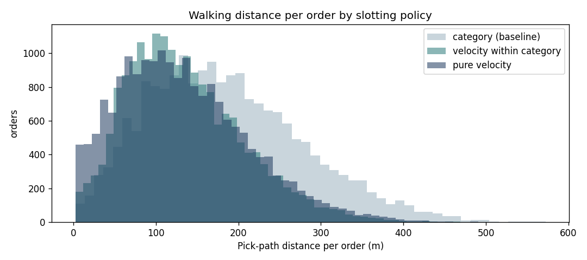

# Dark-Store Ops Lab: slotting, pick paths, staffing and replenishment

How should a quick-commerce dark store lay out its shelves, how many pickers does it need each hour, and when
should each product be replenished? This project answers those questions with **real order data**: Instacart's
public dataset (3.2M orders) stands in for a dark store's order stream.



## Key results
- Measured on 19,064 real orders (7.0 lines each within a 2,000-SKU range; 931 A-class SKUs take 80% of picks).
- **Velocity within category** cut walking from 185 m to 135 m per order (27% less), almost matching pure velocity slotting (133 m, 28%) while keeping departments in their aisles, so it is the practical choice.
- Pick time per order fell 18% (286 s to 236 s), cutting staffing from 179 to 156 picker-hours a day (about 13%) at 1,200 orders/day with 95% of orders starting within 60 s.
- Replenishment: A-class SKUs need an average min of 11 and max of 19 units at a 1-day lead time and ~95% service.
- The top 2,000 SKUs cover only 66% of Instacart picks (a long tail); a curated range would concentrate picks further and likely increase the gains.

## What it does
1. **Range and ABC:** keeps the top 2,000 SKUs (what one dark store might carry) and classifies them A/B/C by pick volume.
2. **Layout model** (`src/layout.py`): 10 aisles × 2 sides × 25 bays × 4 levels, with the packing station at the front.
   Three slotting policies:
   - **category (baseline):** departments fill aisles in order, like a supermarket
   - **velocity within category:** departments keep their aisles, but fast movers go to the front and to waist height
   - **pure velocity:** the fastest movers take the nearest slots regardless of department (upper bound)
3. **Pick paths:** for 20,000 real orders, walking distance under a return-routing policy, converted to pick time
   (walk + seconds per item + seconds per order).
4. **Staffing** (`src/capacity.py`): an Erlang C queueing model gives the fewest pickers each hour so that 95% of
   orders start picking within 60 seconds, using the real hour-of-day order pattern.
5. **Replenishment** (`src/replenishment.py`): min/max (reorder point and order-up-to) per SKU for DC-to-store
   replenishment, with safety stock by ABC class.

## Assumptions (all in `src/config.py`)
1,200 orders/day; walking 1 m/s; 8 s per item line and 45 s per order; 1-day lead time and daily review; day-to-day
demand variability of 30/50/80% for A/B/C. Real store data (pick logs, time-and-motion studies, WMS slot maps)
would replace these; the method stays the same.

## Limits and next steps
- Return routing is a simple, conservative policy; S-shape or optimised routes would shorten every layout.
- Instacart orders are grocery baskets from a US app, used here only as a realistic order stream.
- Next: validate pick times with a time-and-motion study on the floor, pilot velocity-within-category in one store
  and compare pick time per order and mis-picks against a control store.

## Run it
```bash
pip install -r requirements.txt
pytest -q
python run.py --data PATH/TO/instacart/csvs
```
